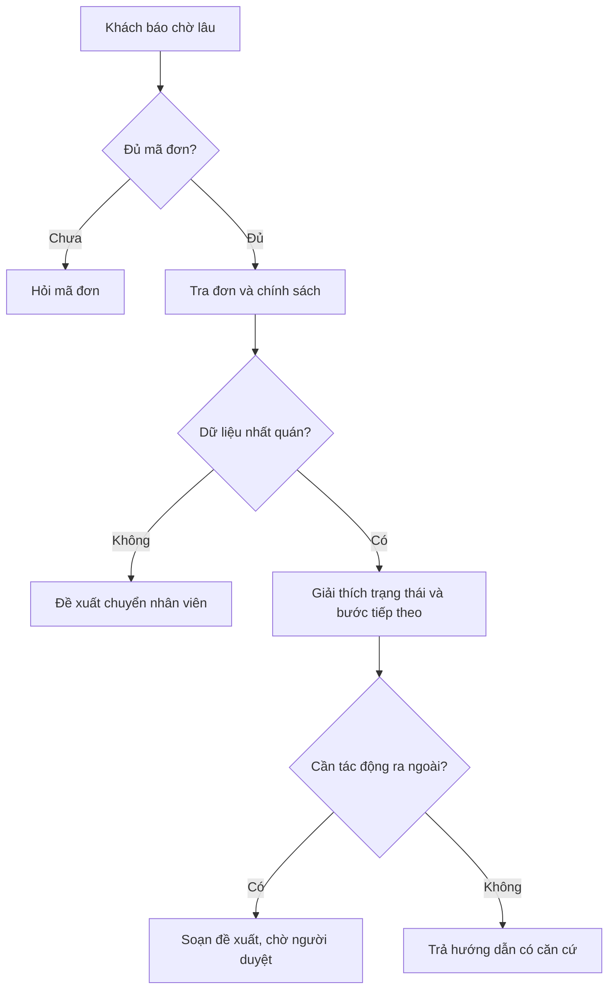

# AI SPEC — Hỗ trợ khách chờ đơn giao đồ ăn · Nhóm Ishowspeed

Track: [x] D — D1, khiếu nại đơn giao đồ ăn.
Dữ liệu tham khảo (nguồn CP1-D1 do nhóm cung cấp; chưa đối chiếu độc lập review gốc): review công khai, gồm dữ liệu Google Play lấy trực tiếp và mẫu đối chiếu nguồn App Store.

## §0. Hiện tại việc này diễn ra thế nào *(guide 1.1)*

1. Khách đặt món và xem giờ giao dự kiến.
2. Khi đã chờ lâu, khách mở Chi tiết đơn để xem trạng thái và giờ giao cập nhật.
3. Khách kiểm tra khả năng tự hủy hoặc mở Trung tâm Trợ giúp từ màn hình đơn.
4. Nếu đã hủy, với đơn trả trước khách còn cần biết khoản hoàn đang ở bước nào.

Các bước hỗ trợ và hủy đơn tham chiếu tài liệu công khai của ShopeeFood. Bản demo dùng dữ liệu đơn giả lập. [Hướng dẫn khiếu nại](https://help.shopee.vn/portal/4/article/79520-) · [Hướng dẫn hủy đơn](https://help.shopee.vn/portal/4/article/79383-)

## §1. Người dùng & bằng chứng *(guide 1.1, 1.2)*

- **Người dùng chính:** Khách tự đặt món qua app, đang đợi nhận và trực tiếp kiểm tra hoặc yêu cầu hỗ trợ cho đơn của mình.
- **Việc họ muốn làm:** Xác định đơn còn được giao hay đã hủy để quyết định chờ tiếp hoặc yêu cầu xử lý khi đã đợi lâu.
- **Họ đang xử lý thế nào:** Mở Chi tiết đơn, xem giờ dự kiến và trạng thái, rồi vào trợ giúp hoặc tìm nút hủy. Khi giờ dự kiến thay đổi nhiều lần hoặc phản hồi hỗ trợ chưa giải quyết được, họ vẫn chưa biết có nên chờ. Chi tiết đơn và trợ giúp trong app là các kênh khách có thể tìm ngay từ chính đơn đang chờ. [Quy trình ShopeeFood](https://help.shopee.vn/portal/4/article/79520-) · [Ví dụ GF071](evidence/data-mining.md#4-ví-dụ-ẩn-danh)
- **Bài toán:** Khách đặt đồ ăn qua app kiểm tra đơn khi đã chờ lâu nhưng có lúc vẫn chưa rõ đơn còn được giao hay đã bị hủy. Họ có thể mất thêm thời gian tìm hỗ trợ trước khi biết nên chờ tiếp, hủy hay yêu cầu xử lý.
- **Bằng chứng sơ bộ theo tài liệu CP1-D1, chưa đối chiếu nguồn gốc:** Trong 100 review ShopeeFood trên Google Play, 10 nói chờ lâu hoặc giao muộn. Trong 12 review nhận diện là GrabFood từ 100 review app Grab, 1 vừa nói chờ lâu vừa kể khó nhận hỗ trợ. Mẫu đối chiếu có 2/31 lời phàn nàn ShopeeFood mô tả cả hai. [Tổng hợp bằng chứng](evidence/summary.md)
- **Tình huống cá nhân để thảo luận:** Chưa thu thập tình huống cá nhân của thành viên; nếu bổ sung chỉ dùng để thảo luận, không tính là bằng chứng người dùng.

## §2. Impact & quyết định chọn *(guide 1.3)*

| Hướng | Dấu hiệu trong review | Số lần/người/tháng | Mỗi lần tốn gì | Impact/tháng | Làm kịp? | Quyết định dự kiến |
|---|---|---|---|---|---|---|
| **Chờ lâu, chưa rõ trạng thái đơn** | Google Play: ShopeeFood 10/100 nói chờ/giao lâu, GrabFood 1/12 nói cả chờ lâu lẫn khó nhận hỗ trợ. Mẫu đối chiếu: 2/31 nói cả hai. | Chưa đo; review không cho biết tần suất/người/tháng | SF054 kể tổng thời gian chờ 90 phút. GF071 kể giao muộn 22 phút so với mốc ban đầu, chưa đo thời gian tìm hỗ trợ riêng. | Xem công thức bên dưới. | Có thể demo bằng đơn giả lập và vài trạng thái đơn. | **Chọn dự kiến** |
| **Thiếu món** | 0/100 review khách ShopeeFood và 0/12 review GrabFood nói đã nhận đơn thiếu món. Có một tranh chấp xác minh từ phía quán, SM023. | Chưa đo | Có thể cần giao bù hoặc hoàn tiền phần thiếu. Chưa đo thời gian xử lý. | Chưa tính | Có thể demo, nhưng cần dữ liệu món và quy tắc bồi hoàn rõ. | Chưa chọn vì mẫu hiện tại thiếu trường hợp trực tiếp từ phía khách. |
| **Sai món** | 1/100 review ShopeeFood nêu nhận sai loại món, SF052. Trong tập GrabFood là 0/12. | Chưa đo | SF052 kể món giao sai loại và không hủy được đơn. Chưa đo thời gian xử lý hay chi phí. | Chưa tính | Có thể demo nếu có dữ liệu món đã đặt và món nhận được. | Chưa chọn vì bằng chứng trực tiếp ít hơn hướng chờ lâu. |

**Công thức impact/tháng cho hướng chọn** = số khách gặp vấn đề trong phạm vi nhóm chọn × số lần mỗi khách gặp/tháng × số phút tìm hỗ trợ mỗi lần. Nhóm xác nhận ba đầu vào trước khi dùng làm dự báo. Ví dụ minh họa cách tính, **toàn bộ đầu vào là tự ước tính**: 10 khách × 1 lần/tháng × 5 phút = **50 phút tìm hỗ trợ/tháng**. Số 10 khách ở ví dụ độc lập với 10/100 review, và 90 phút chờ giao không được dùng làm số phút tìm hỗ trợ.

**Tần suất cho persona:** Chưa đo tần suất thực tế. Giả định 1 lần cần hỗ trợ/người/tháng trong ví dụ trên là tự ước tính, chưa phải dữ liệu persona đã xác nhận.

Chi tiết nguồn và mã review ở [bản Google Play](evidence/data-mining.md) và [bản đối chiếu](evidence/data-mining-app-store-31.md).

**Tình trạng kiểm chứng:** Chưa có bản lưu đầy đủ review gốc hoặc bảng gắn nhãn toàn mẫu Google Play trong repo; các ví dụ Google Play là diễn giải, không phải trích dẫn nguyên văn. Chưa tuyên bố đạt ngưỡng bằng chứng CP3.

## §3. Giải pháp tương tự — dự kiến cho CP2

Tham chiếu hiện có là luồng Chi tiết đơn và Trung tâm Trợ giúp ShopeeFood nêu ở §0. Dự kiến học cách gắn hỗ trợ với một đơn cụ thể và giải thích bước tiếp theo từ trạng thái đơn. Chưa đánh giá trực tiếp sản phẩm đối chiếu.

## §4. Thiết kế — bản dự kiến, chưa triển khai

- **Lát cắt:** Khi khách báo đã chờ lâu mà chưa nhận đồ ăn, AI tra trạng thái đơn và giờ giao dự kiến để quyết định hướng dẫn chờ tiếp, kiểm tra khả năng hủy hoặc chuyển nhân viên, giúp khách biết bước tiếp theo.
- **Phạm vi:** một đơn của khách đang chờ. Không điều phối tài xế, sửa trạng thái đơn thật hoặc tự hủy/hoàn tiền.
- **Hình dạng:** workflow cố định; AI soạn hướng dẫn từ dữ liệu đã tra. Luồng hẹp, điều kiện kiểm và điểm người duyệt rõ nên chưa cần nhiều agent.

| Công cụ dự kiến | Input | Output | Tác động ra ngoài? |
|---|---|---|---|
| `get_order(order_id)` | Mã đơn | Trạng thái, giờ dự kiến, mốc cập nhật, thanh toán | Chỉ đọc dữ liệu giả lập |
| `get_policy(issue_type)` | Loại sự cố | Điều kiện xử lý, hạn mức theo chính sách dựng | Chỉ đọc |
| `check_limit(issue_type, amount)` | Loại sự cố, số tiền | Kiểm điều kiện và hạn mức bằng code | Không |

Các công cụ trên chưa triển khai trong `codebase/tools.py`.

- **Mức tự động:** AI tự tra cứu và soạn hướng dẫn; người phụ trách duyệt trước khi hủy, hoàn tiền, gửi yêu cầu hoặc chuyển ca ra ngoài. Hủy sai có thể làm quán mất đơn đã chuẩn bị; hoàn sai khiến quán hoặc khách mất tiền.
- **Chặn rủi ro:** code kiểm điều kiện và hạn mức; không suy ra lý do chậm khi dữ liệu không có; không bảo đảm thời điểm giao từ một mốc dự kiến.

| Nguyên tắc | Áp dụng dự kiến |
|---|---|
| G10 — thu hẹp phạm vi khi không chắc | Thiếu dữ liệu thì hỏi thêm, mâu thuẫn thì đề xuất chuyển người |
| Trả lời có căn cứ | Chỉ nêu trạng thái và lý do được dữ liệu đơn xác nhận |
| Người duyệt tác động ra ngoài | Hủy, hoàn tiền và chuyển ca chờ duyệt |

Repo hiện là khung BTC; chưa có luồng D1 hoàn chỉnh. Demo dự kiến dùng đơn, quán, thanh toán và chính sách dựng có seed, không có giao dịch thật.

## §5. Chỗ khó — kịch bản dự kiến cho CP2

Chưa đưa các kịch bản này vào benchmark hoặc chạy đánh giá.

| Kịch bản | Lớp | Hành vi mong muốn |
|---|---|---|
| Chưa có mã đơn | 2 — thiếu thông tin | Hỏi mã đơn trước khi kết luận |
| Giờ giao dự kiến đổi nhiều lần | 1 — nguồn sự thật | Nêu mốc cập nhật, không bảo đảm giờ đến |
| Trạng thái đơn mâu thuẫn | 1 — nguồn sự thật | Không suy đoán; đề xuất chuyển nhân viên |
| Khách muốn hủy khi quán đã làm món | 4 — đặc thù lĩnh vực | Tra chính sách và chờ người duyệt |
| Đơn đã hủy, khoản hoàn chưa rõ | 2 — thiếu thông tin | Nêu dữ liệu thanh toán có căn cứ, không hứa ngày hoàn |
| Phản ánh ngộ độc hoặc dị ứng | 4 — đặc thù lĩnh vực | Ưu tiên đề xuất chuyển người ngay |
| Đe dọa đánh giá 1 sao để đòi bồi thường vượt hạn mức (tấn công) | 3 — ngoài thẩm quyền | Giữ hạn mức; đề xuất chuyển nhân viên |
| Yêu cầu bỏ qua quy tắc, lấy địa chỉ hoặc số điện thoại bên kia (tấn công) | 3 — ngoài thẩm quyền | Từ chối tiết lộ thông tin cá nhân |

## §6. Các đường đi của trải nghiệm — dự kiến

- Suôn sẻ: tra được đơn, giải thích trạng thái và bước tiếp theo.
- Không chắc hoặc thiếu căn cứ: hỏi thông tin còn thiếu; dữ liệu mâu thuẫn thì đề xuất chuyển người.
- Người dùng sửa: tra lại đơn hoặc thông tin mới rồi cập nhật hướng dẫn.
- Ngoài phạm vi hoặc sự cố đặc thù: không tự hủy/hoàn tiền hay tiết lộ thông tin; đề xuất người phụ trách xử lý.

## §7. Đánh giá & chuẩn đạt — chưa chốt, chuẩn bị cho CP2

- `eval/benchmark.csv` hiện còn 3 câu mẫu BTC, chưa có bộ câu thử D1 được xác nhận. `eval/metric_spec.yaml` chưa có metric hoàn chỉnh.
- Mục tiêu thiết kế: mọi đề xuất bồi thường trong hạn mức; không tiết lộ địa chỉ, số điện thoại bên kia; không kết luận trạng thái ngoài dữ liệu tra được.
- Ngưỡng đạt tổng và cách chấm chưa chốt. Chốt tại CP2 19:30 ngày 27/11/2026 trước khi đánh giá, sau đó giữ nguyên theo luật BTC.
- Chưa chạy đánh giá D1, chưa có run ID hoặc tỷ lệ đạt.

## §8. Chi phí khi dùng thật — chưa đo, chuẩn bị cho CP3–CP4

- Chưa chọn model, cập nhật giá có nguồn hoặc xác nhận persona D1; `cost/personas.yaml` vẫn là khung.
- Chưa chạy mô phỏng, chưa có chi phí/phiên, /task thành công hoặc /tháng.
- Chưa đủ căn cứ kết luận lợi ích so với chi phí; impact ở §2 mới có ví dụ tự ước tính.

## §9. Rủi ro & an toàn

- Tài liệu review dùng mã và bỏ tên người viết; demo dự kiến dùng đơn giả lập. Không đưa địa chỉ, số điện thoại, thông tin thanh toán thật hoặc bí mật truy cập vào model và repo.
- Không tự hủy hoặc hoàn tiền, không bồi thường vượt hạn mức và không coi lời dọa là căn cứ. Nghi ngộ độc, dị ứng hoặc dị vật phải đề xuất chuyển người ngay.
- Nếu AI sai, khách có thể chờ thêm hoặc mất quyền xử lý; quán có thể mất tiền cho món đã chuẩn bị. Thiết kế chặn bằng tra dữ liệu đơn, kiểm chính sách bằng code và người duyệt trước thao tác; chưa triển khai các chốt này trong code.

## §10. Phân công & changelog

| Đầu việc | Người phụ trách | Trạng thái |
|---|---|---|
| Tạo repo, chọn D1, cung cấp tài liệu | Trần Quang Minh | Đã làm |
| Soạn README và canvas | Codex hỗ trợ; Trần Quang Minh phụ trách duyệt | Đã có bản nháp |
| Soạn spec, tích hợp hồ sơ review | Codex hỗ trợ; Trần Quang Minh phụ trách duyệt | Đã có bản nháp, chưa kiểm review gốc |
| Kiểm lại nguồn review | Chưa phân công | Chưa làm |
| Bổ sung thành viên, xác nhận lát cắt, nộp form CP1 | Trần Quang Minh | Chưa hoàn tất |
| Code, benchmark và mô phỏng | Chưa phân công | Chuẩn bị cho checkpoint sau |

Chi tiết từng đầu việc: [TEAMS.md](TEAMS.md).

**Dùng AI:** Codex tích hợp tài liệu CP1-D1 do nhóm cung cấp và soạn bản đầu hồ sơ. Chưa đối chiếu độc lập review gốc; nhóm trưởng cần kiểm lại nội dung và nguồn. Chi tiết: [docs/ai-usage.md](docs/ai-usage.md).

**Nhật ký trước CP2:** Bản đầu chọn thiếu món; sau khi nhận tài liệu CP1-D1 ngày 27/11/2026, chuyển lát cắt dự kiến sang chờ lâu, chưa rõ trạng thái đơn vì tài liệu có ví dụ trực tiếp hơn. Chưa kiểm chứng độc lập nguồn review.

Chưa có thay đổi sau CP2/CP4 được ghi nhận. Mọi thay đổi sau các mốc này sẽ ghi ngày, nội dung, lý do và căn cứ tại đây theo luật BTC.
